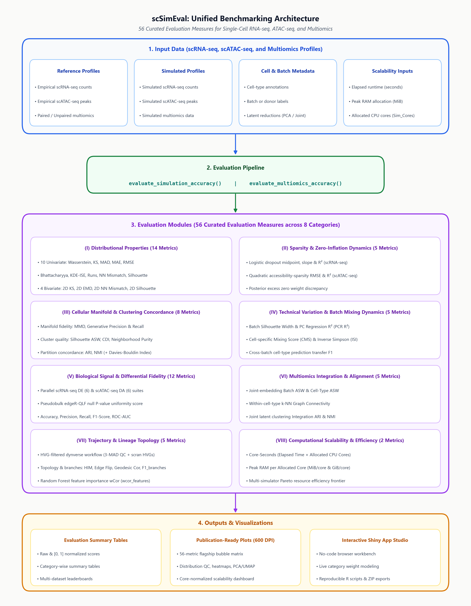

# scSimEval: Unified Benchmarking and Accuracy Evaluation for Single-Cell Multiomics Simulation Methods <a href="https://kabilanbio.github.io/scSimEval/"></a>

[](https://opensource.org/licenses/MIT)
[](https://kabilanbio.github.io/scSimEval/)
[](https://github.com/BiocStaging/scSimEval)

**`scSimEval`** is a unified evaluation and benchmarking toolkit designed to systematically quantify how faithfully single-cell simulation methods reproduce empirical biological experiments.

The package supports:
- **scRNA-seq** (Single-cell transcriptomic count matrices)
- **scATAC-seq** (Single-cell chromatin accessibility peak matrices)
- **Paired Multiomics** (Simultaneous co-assays across identical cells, e.g., 10x Multiome, SHARE-seq)
- **Unpaired Multiomics** (Independent scRNA-seq and scATAC-seq profiled from separate cells of the same biological system)

---

## Workflow Overview

<p align="center">
  
</p>

---

## Key Features

- **55 Curated Evaluation Measures Across 8 Canonical Categories**:
  1. *Distributional Properties* (14 metrics: 10 univariate---Wasserstein, KS, MAD, MAE, RMSE, Bhattacharyya, KDE-ISE, Runs statistic, NN mismatch, Inter-dataset silhouette---and 4 bivariate---Fasano-Franceschini 2D KS, 2D EMD, 2D NN mismatch, 2D Inter-dataset silhouette---across 7 cell-level, 7 feature-level, and 4 bivariate property pairs)
  2. *Sparsity & Zero-Inflation Dynamics* (5 metrics: logistic dropout midpoint/slope/R² for scRNA-seq, quadratic accessibility-sparsity curve RMSE/R² for scATAC-seq, and posterior excess zero weight discrepancy)
  3. *Cellular Manifold & Clustering Concordance* (8 primary metrics: MMD, Generative Precision, Generative Recall, Silhouette ASW, Clustering Deviation Index [CDI], Neighborhood Purity, ARI, NMI, plus auxiliary Davies-Bouldin Index)
  4. *Technical Variation & Batch Mixing Dynamics* (5 metrics: Batch Silhouette, PCR $R^2$, CMS, Inverse Simpson Index [ISI], Cross-Batch F1)
  5. *Biological Signal & Differential Fidelity* (12 metrics: parallel scRNA-seq DE and scATAC-seq DA suites assessing null P-value uniformity, accuracy, precision, recall, F1-score, and ROC-AUC via pseudobulk edgeR-QLF)
  6. *Multiomics Integration & Alignment* (5 metrics: joint-embedding Batch ASW, Cell-Type ASW, Graph Connectivity, Integration ARI, and Integration NMI)
  7. *Trajectory & Lineage Topology* (4 metrics: pseudotime correlation, lineage tree branch height RMSE, trajectory graph alignment, lineage gene expression fidelity)
  8. *Computational Scalability & Efficiency* (2 metrics: elapsed execution time in seconds and peak memory allocation in MB/MiB)
- **Robust Normalization Engine**: Automated library-size scaling, $\log_2(\text{CPM}+1)$ transformation, and joint low-dimensional latent projections prevent technical sequencing-depth artifacts from confounding evaluations.
- **Low-Dimensional Cell Embeddings**: Multi-simulator UMAP, t-SNE, and PCA projections comparing reference and simulated cells in grid or 1-to-1 layouts, accompanied by quantitative clustering and manifold quality metrics.
- **Publication-Ready Figures & Reproducible R Scripts**: Generates 600 DPI vector graphics and 100% procedural, self-contained R workflow scripts (free of hardcoded `dput` dumps) equipped with dedicated file path configuration blocks for local or HPC cluster execution.
- **Interactive Shiny App Studio (`scSimEvalApp`)**: Full-featured, no-code graphical user interface for interactive benchmark exploration, live dataset QC inspection, modality filtering, and multi-format report exports.

---

## Installation

Install the development version of `scSimEval` from GitHub:

```R
if (!requireNamespace("remotes", quietly = TRUE)) {
  install.packages("remotes")
}

remotes::install_github("kabilanbio/scSimEval")
```

---

## Quick Start

### 1. Unimodal Evaluation (scRNA-seq / scATAC-seq)

```R
library(scSimEval)

# Load packaged scRNA-seq reference and simulation
data(example_scrna)

# Evaluate simulation accuracy against empirical reference
res_uni <- evaluate_simulation_accuracy(
  ref_data = example_scrna$ref,
  sim_data = example_scrna$sim,
  verbose  = FALSE
)

# Inspect evaluated metrics summary
head(res_uni$metrics_summary_table)
```

### 2. Multiomics Accuracy Evaluation (Paired / Unpaired)

```R
# Load packaged Option B Seurat v5 paired multiomics dataset (Rice Bud)
data(example_rice_bud)

# Benchmark scMultiSim against empirical reference (cell_type, batch, and reductions are auto-extracted)
res_multi <- evaluate_multiomics_accuracy(
  ref_multi  = example_rice_bud$reference$combined,
  sim_multi  = example_rice_bud$simulated$scMultiSim$combined,
  pairing    = "paired",
  verbose    = FALSE
)

# Review composite benchmark scores
head(res_multi$benchmark_summary_table)
```

### 3. High-Resolution Visualizations

```R
# Plot the flagship comparative bubble matrix across evaluation categories
plot_benchmark_bubble_matrix(res_multi$benchmark_summary_table)

# Plot distribution QC curves (library size, expression density, dropout)
plot_distribution_qc(
  ref_data = example_rice_bud$reference$rna,
  sim_data = example_rice_bud$simulated$scMultiSim$rna
)
```

### 4. Interactive Graphical User Interface (Shiny Studio)

Launch the interactive web application directly from R:

```R
launch_scSimEval_app()
```

---

## Built-in Real Biological Datasets (Option B Standardized `Seurat` v5)

`scSimEval` includes standardized empirical benchmarks extracted from published studies, complete with raw integer `counts`, harmonized `cell_type` and `batch` metadata, and dimensional reductions (`integrated`, `pca`):

- **`example_rice_bud`**: Real paired single-cell multiomics dataset from rice (*Oryza sativa*) bud tissue (100 paired cells, 200 genes, 200 peaks, 4 cell types, 2 batches) evaluated across 6 simulators (`scMultiSim`, `scDesign3`, `MOSim`, `scCross`, `scMoMtF`, `Matilda`). Includes `$combined`, `$rna`, and `$atac` `Seurat` objects.
- **`example_soybean_root`**: Real unpaired single-cell multiomics dataset from soybean (*Glycine max*) root tissue (100 RNA cells, 100 ATAC cells, 200 genes, 200 peaks, 4 cell types, 2 batches) evaluated across 3 simulators (`scMultiSim`, `scDesign3`, `scCross`). Includes `$combined`, `$rna`, and `$atac` `Seurat` objects.
- **`example_scrna`** & **`example_scatac`**: Lightweight unimodal benchmarks for rapid exploratory prototyping.

---

## Comprehensive Documentation

For complete tutorials, metric mathematical formulations, hardware recommendations, and function reference manuals, please visit our documentation website:

👉 **[https://kabilanbio.github.io/scSimEval/](https://kabilanbio.github.io/scSimEval/)**

Detailed in-app guides and file templates are also available directly within the **Help & Getting Started** tab of `launch_scSimEval_app()`.

---

## Authors & Maintainers

`scSimEval` is developed and maintained at the **Division of Agricultural Bioinformatics, ICAR-Indian Agricultural Statistics Research Institute (ICAR-IASRI)**, New Delhi, India:

- **Kabilan Sakthivel** (Maintainer & Ph.D Scholar) — `kabilan151414@gmail.com`
- **Dr. Dwijesh Chandra Mishra** (Principal Scientist & Thesis Guide) — `dwij.mishra@gmail.com`
- **Dr. Shashi Bhushan Lal** (Author) — `sblall16@gmail.com`
- **Dr. Sudhir Srivastava** (Author) — `sudhir0401bm@gmail.com`
- **Dr. Krishna Kumar Chaturvedi** (Author) — `kkcchaturvedi@gmail.com`
- **Dr. Sharanbasappa** (Contributor) — `smadival509@gmail.com`

- **Bug Reports & Issues:** [https://github.com/kabilanbio/scSimEval/issues](https://github.com/kabilanbio/scSimEval/issues)

---
