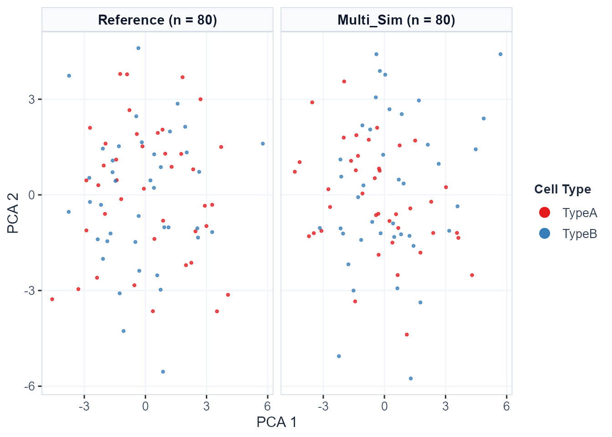

# Demonstration 3: Multiomics (scRNA-seq + scATAC-seq) Simulation Evaluation

## Introduction

Single-cell multiomics technologies allow simultaneous or parallel
measurement of multiple cellular features — most commonly gene
expression (scRNA-seq) and chromatin accessibility (scATAC-seq).
Simulating multiomics data presents unique challenges because algorithms
must preserve not only the distinct statistical properties of each
individual modality, but also the biological coupling and regulatory
relationships between them.

`scSimEval` is designed to evaluate simulation fidelity across **two
primary multiomics experimental designs**, each tailored to the level of
cell-level pairing between modalities: **Paired Multiomics** (co-assay
profiling of identical individual cells) and **Unpaired Multiomics**
(independent profiling of separate cells from the same biological
system). Understanding which design your simulated data belongs to is
essential for selecting the correct evaluation functions.

------------------------------------------------------------------------

## Part 1: Understanding Multiomics Data Types

### 1.1 Paired Multiomics (Co-assay)

**Definition:** Both scRNA-seq and scATAC-seq are measured
**simultaneously from the exact same individual cells**. Each cell
barcode in the RNA matrix has a corresponding and biologically
meaningful entry at the same column index in the ATAC matrix.

**Technologies:** 10x Chromium Multiome, SHARE-seq, SNARE-seq,
Paired-seq, ASTAR-seq

**Simulators:** scMultiSim (Li et al., *Nat Methods* 2023),
SymSim2+ATAC, MultiSim

**What scSimEval can evaluate:**

- ✅ Full unimodal evaluation for each modality (Categories 1–5, 7, and
  8)
- ✅ **All** Category 6 multiomics integration & alignment metrics
  ([`evaluate_multiomics_integration()`](https://kabilanbio.github.io/scSimEval/reference/evaluate_multiomics_integration.md)):
  - `batch_asw` (Batch Average Silhouette Width in joint embedding
    space)
  - `cell_type_asw` (Cell-Type Average Silhouette Width in joint
    embedding space)
  - `graph_connectivity` (Within-cell-type k-NN graph connectivity)
  - `ari` (Adjusted Rand Index on joint latent clustering)
  - `nmi` (Normalized Mutual Information on joint latent clustering)

------------------------------------------------------------------------

### 1.2 Unpaired Multiomics (Independent profiling)

**Definition:** scRNA-seq and scATAC-seq are profiled **from different
cells** derived from the same biological tissue, cell line, or sample.
Cell barcodes do **not** correspond between modalities — column *i* of
the RNA matrix and column *i* of the ATAC matrix represent entirely
different cells.

**Technologies:** Bulk ATAC + scRNA-seq, independent 10x scATAC + scRNA
experiments on the same tissue, sci-ATAC-seq paired with scRNA-seq on
sibling aliquots

**Simulators:** scDesign3, scMultiSim, scCross

**What scSimEval can evaluate:**

- ✅ Full unimodal evaluation for each modality independently
  (Categories 1–5, 7, and 8)
- ✅ Joint-embedding multiomics integration metrics (Category 6) when
  pre-integrated embeddings (`integrated` or `pca`) are supplied on the
  combined multiomics object via `pairing = "unpaired"` in
  [`evaluate_multiomics_accuracy()`](https://kabilanbio.github.io/scSimEval/reference/evaluate_multiomics_accuracy.md).

------------------------------------------------------------------------

### 1.3 Metric Compatibility Summary

| Metric / Function | Paired | Unpaired |
|----|:--:|:--:|
| [`evaluate_simulation_accuracy()`](https://kabilanbio.github.io/scSimEval/reference/evaluate_simulation_accuracy.md) per modality | ✅ | ✅ |
| [`evaluate_clustering_metrics()`](https://kabilanbio.github.io/scSimEval/reference/evaluate_clustering_metrics.md) | ✅ | ✅ |
| [`evaluate_batch_metrics()`](https://kabilanbio.github.io/scSimEval/reference/evaluate_batch_metrics.md) | ✅ | ✅ |
| [`evaluate_deg_fidelity()`](https://kabilanbio.github.io/scSimEval/reference/evaluate_deg_fidelity.md) | ✅ | ✅ |
| [`evaluate_trajectory_metrics()`](https://kabilanbio.github.io/scSimEval/reference/evaluate_trajectory_metrics.md) *(scRNA-seq only)* | ✅ | ✅ |
| [`evaluate_multiomics_integration()`](https://kabilanbio.github.io/scSimEval/reference/evaluate_multiomics_integration.md) | ✅ | ✅ (via joint embedding) |
| **[`evaluate_multiomics_accuracy()`](https://kabilanbio.github.io/scSimEval/reference/evaluate_multiomics_accuracy.md)** | ✅ (`pairing = "paired"`) | ✅ (`pairing = "unpaired"`) |

------------------------------------------------------------------------

## Part 2: Evaluating Paired Multiomics

### 2.1 Loading the Example Paired Dataset

`scSimEval` includes a paired scRNA-seq + scATAC-seq dataset
(`example_multiomics`) where every column in the RNA matrix corresponds
to the same cell in the ATAC matrix:

\
[`library`](https://rdrr.io/r/base/library.html)`(`[`scSimEval`](https://kabilanbio.github.io/scSimEval/)`)`\
\
`# Load packaged paired multiomics example dataset`\
[`data`](https://rdrr.io/r/utils/data.html)`(``example_multiomics``)`\
\
[`cat`](https://rdrr.io/r/base/cat.html)`(``"Reference RNA dimensions:"``, `[`dim`](https://rdrr.io/r/base/dim.html)`(``example_multiomics``$``ref_multi``$``rna``)``, ``"\n"``)`\
`#> Reference RNA dimensions: 60 80`\
[`cat`](https://rdrr.io/r/base/cat.html)`(``"Reference ATAC dimensions:"``, `[`dim`](https://rdrr.io/r/base/dim.html)`(``example_multiomics``$``ref_multi``$``atac``)``, ``"\n"``)`\
`#> Reference ATAC dimensions: 60 80`\
[`cat`](https://rdrr.io/r/base/cat.html)`(``"Simulated RNA dimensions:"``, `[`dim`](https://rdrr.io/r/base/dim.html)`(``example_multiomics``$``sim_multi``$``rna``)``, ``"\n"``)`\
`#> Simulated RNA dimensions: 60 80`\
[`cat`](https://rdrr.io/r/base/cat.html)`(``"Simulated ATAC dimensions:"``, `[`dim`](https://rdrr.io/r/base/dim.html)`(``example_multiomics``$``sim_multi``$``atac``)``, ``"\n"``)`\
`#> Simulated ATAC dimensions: 60 80`\
[`cat`](https://rdrr.io/r/base/cat.html)`(``"Cell types:"``, `[`levels`](https://rdrr.io/r/base/levels.html)`(``example_multiomics``$``cell_types``)``, ``"\n"``)`\
`#> Cell types: TypeA TypeB`

The dataset contains:

- `ref_multi`: Named list `rna` (count matrix) and `atac` (peak
  accessibility matrix), both measured from the **same cells**.
- `sim_multi`: Simulated paired `rna` and `atac` matrices.
- `cell_types`: Cell type annotations shared across both modalities.
- `batch_info`: Batch labels shared across both modalities.
- `resource_stats`: Hardware logs (runtime in seconds and peak RAM in
  MiB).

------------------------------------------------------------------------

### 2.2 Multiomics Integration & Alignment (Category VI)

Category VI evaluates multiomics integration and biological preservation
using gold-standard metrics from `scib`, `scMultiSim`, `scCross`,
`Matilda`, and `scMoMtF`:

\
`int_res`` ``<-`` `[`evaluate_multiomics_integration`](https://kabilanbio.github.io/scSimEval/reference/evaluate_multiomics_integration.md)`(`\
`  ref_multi  ``=`` ``example_multiomics``$``ref_multi``,`\
`  sim_multi  ``=`` ``example_multiomics``$``sim_multi``,`\
`  cell_types ``=`` ``example_multiomics``$``cell_types``,`\
`  batch_info ``=`` ``example_multiomics``$``batch_info``,`\
`  verbose    ``=`` ``FALSE`\
`)`\
\
[`print`](https://rdrr.io/r/base/print.html)`(``int_res``$``integration_summary_table``)`\
`#>                                  Category               Property`\
`#> 1 (VI) Multiomics Integration & Alignment multiomics_integration`\
`#> 2 (VI) Multiomics Integration & Alignment multiomics_integration`\
`#> 3 (VI) Multiomics Integration & Alignment multiomics_integration`\
`#> 4 (VI) Multiomics Integration & Alignment multiomics_integration`\
`#> 5 (VI) Multiomics Integration & Alignment multiomics_integration`\
`#>               Metric     Value            Modality`\
`#> 1          batch_asw 0.9762642 Joint (Cross-Modal)`\
`#> 2      cell_type_asw 0.5582026 Joint (Cross-Modal)`\
`#> 3 graph_connectivity 1.0000000 Joint (Cross-Modal)`\
`#> 4                ari 0.6765538 Joint (Cross-Modal)`\
`#> 5                nmi 0.5821401 Joint (Cross-Modal)`

------------------------------------------------------------------------

### 2.3 Master Paired Pipeline: `evaluate_multiomics_accuracy()`

For fully paired data, the master function coordinates all 8 categories:

\
`master_eval`` ``<-`` `[`evaluate_multiomics_accuracy`](https://kabilanbio.github.io/scSimEval/reference/evaluate_multiomics_accuracy.md)`(`\
`  ref_multi  ``=`` ``example_multiomics``$``ref_multi``,`\
`  sim_multi  ``=`` ``example_multiomics``$``sim_multi``,`\
`  cell_types ``=`` ``example_multiomics``$``cell_types``,`\
`  elapsed_time ``=`` ``example_multiomics``$``resource_stats``$``elapsed_time``,`\
`  memory_mb    ``=`` ``example_multiomics``$``resource_stats``$``memory_mb``,`\
`  verbose      ``=`` ``FALSE`\
`)`\
\
[`head`](https://rdrr.io/r/utils/head.html)`(``master_eval``$``benchmark_summary_table``)`\
`#>                    Category     Property         Metric         Value Modality`\
`#> 1 Distributional Properties library_size    Wasserstein 15.0625000000      rna`\
`#> 2 Distributional Properties library_size             KS  0.2125000000      rna`\
`#> 3 Distributional Properties library_size            MAD 15.0000000000      rna`\
`#> 4 Distributional Properties library_size  Bhattacharyya  0.0001188839      rna`\
`#> 5 Distributional Properties library_size Runs_Statistic -1.7447479960      rna`\
`#> 6 Distributional Properties library_size    NN_Mismatch  0.1750000000      rna`

> **Parallel Multi-Core Acceleration (`threads`):** On multi-core
> systems or HPC nodes, set `threads = 4` or `threads = 8` to accelerate
> the dual unimodal layer evaluations and Category 6 cross-modal
> correlation computations across CPU worker threads via `BiocParallel`.

------------------------------------------------------------------------

## Part 3: Evaluating Unpaired Multiomics

For unpaired data, scRNA-seq and scATAC-seq come from **different
cells**. The recommended workflow is to evaluate each modality
independently and combine results.

### 3.1 Step-by-Step Workflow for Unpaired Data

\
[`library`](https://rdrr.io/r/base/library.html)`(`[`scSimEval`](https://kabilanbio.github.io/scSimEval/)`)`\
[`data`](https://rdrr.io/r/utils/data.html)`(``example_scrna``)``   ``# RNA modality`\
[`data`](https://rdrr.io/r/utils/data.html)`(``example_scatac``)``  ``# ATAC modality (different cells)`\
\
`# ── Step 1: Evaluate each modality independently ──────────────────────────────`\
`rna_eval`` ``<-`` `[`evaluate_simulation_accuracy`](https://kabilanbio.github.io/scSimEval/reference/evaluate_simulation_accuracy.md)`(`\
`  ref_data ``=`` ``example_scrna``$``ref``,`\
`  sim_data ``=`` ``example_scrna``$``sim``,`\
`  compute_bivariate ``=`` ``FALSE``,`\
`  verbose ``=`` ``FALSE`\
`)`\
\
`atac_eval`` ``<-`` `[`evaluate_simulation_accuracy`](https://kabilanbio.github.io/scSimEval/reference/evaluate_simulation_accuracy.md)`(`\
`  ref_data ``=`` ``example_scatac``$``ref``,`\
`  sim_data ``=`` ``example_scatac``$``sim``,`\
`  compute_bivariate ``=`` ``FALSE``,`\
`  verbose ``=`` ``FALSE`\
`)`\
\
`# ── Step 2: Consolidate and compare across modalities ─────────────────────────`\
`dataset_collection`` ``<-`` `[`list`](https://rdrr.io/r/base/list.html)`(`\
`  ``"Method_A-RNA"``  ``=`` `[`list`](https://rdrr.io/r/base/list.html)`(``ref ``=`` ``example_scrna``$``ref``,  sim ``=`` ``example_scrna``$``sim``)``,`\
`  ``"Method_A-ATAC"`` ``=`` `[`list`](https://rdrr.io/r/base/list.html)`(``ref ``=`` ``example_scatac``$``ref``, sim ``=`` ``example_scatac``$``sim``)`\
`)`\
\
`consolidated`` ``<-`` `[`evaluate_multiple_datasets`](https://kabilanbio.github.io/scSimEval/reference/evaluate_multiple_datasets.md)`(`\
`  datasets          ``=`` ``dataset_collection``,`\
`  pair_by_prefix    ``=`` ``TRUE``,`\
`  compute_bivariate ``=`` ``FALSE``,`\
`  verbose           ``=`` ``FALSE`\
`)`\
\
[`print`](https://rdrr.io/r/base/print.html)`(``consolidated``$``dataset_overview``)`

------------------------------------------------------------------------

## Part 4: Visualization

`scSimEval` visualization functions work seamlessly across unimodal,
paired, and unpaired multiomics configurations:

\
`# Multi-dataset consolidated benchmark bubble matrix`\
[`plot_benchmark_bubble_matrix`](https://kabilanbio.github.io/scSimEval/reference/plot_benchmark_bubble_matrix.md)`(`\
`  data  ``=`` ``consolidated``,`\
`  title ``=`` ``"Benchmarking Multiomics Simulators"`\
`)`\
\
`# Evaluation summary horizontal bar matrix`\
[`plot_evaluation_summary`](https://kabilanbio.github.io/scSimEval/reference/plot_evaluation_summary.md)`(`\
`  data  ``=`` ``consolidated``,`\
`  title ``=`` ``"Multiomics Simulator Leaderboard"`\
`)`

### 4.1 Low-Dimensional Multiomics Cell Embeddings

To visually examine whether simulated cells maintain the biological
manifold of empirical data across modalities, researchers can project
reference and simulated cells into low-dimensional UMAP, t-SNE, or PCA
coordinates:

\
`# Compute low-dimensional embeddings for the scRNA-seq modality`\
`emb_rna`` ``<-`` `[`compute_dataset_embeddings`](https://kabilanbio.github.io/scSimEval/reference/compute_dataset_embeddings.md)`(`\
`  reference   ``=`` ``example_multiomics``$``ref_multi``$``rna``,`\
`  simulated   ``=`` `[`list`](https://rdrr.io/r/base/list.html)`(``"Multi_Sim"`` ``=`` ``example_multiomics``$``sim_multi``$``rna``)``,`\
`  reduction   ``=`` ``"pca"``,`\
`  n_pcs       ``=`` ``5``,`\
`  cell_types  ``=`` ``example_multiomics``$``cell_types`\
`)`\
\
`# Plot multiomics cell embeddings`\
[`plot_dataset_embeddings`](https://kabilanbio.github.io/scSimEval/reference/plot_dataset_embeddings.md)`(`\
`  embedding_data ``=`` ``emb_rna``,`\
`  reduction      ``=`` ``"pca"``,`\
`  layout         ``=`` ``"side_by_side"``,`\
`  color_by       ``=`` ``"cell_type"`\
`)`

\
\
`# Quantitative embedding quality metrics`\
`knitr``::`[`kable`](https://rdrr.io/pkg/knitr/man/kable.html)`(`[`compute_embedding_quality_metrics`](https://kabilanbio.github.io/scSimEval/reference/compute_embedding_quality_metrics.md)`(``emb_rna``)``, digits ``=`` ``4``)`

| Dataset | Role | Cells (N) | Mean Silhouette | ARI (Cluster Fidelity) | Mean Library Size | Mean Detected Features | Library Size Diff (%) |
|:---|:---|---:|---:|---:|---:|---:|---:|
| Reference | Reference | 80 | -0.0101 | -0.0027 | 256.3 | 49.2 | 0.00 |
| Multi_Sim | Simulated | 80 | 0.0037 | -0.0071 | 242.3 | 48.3 | 5.46 |

------------------------------------------------------------------------

## Part 5: Summary

| Data Type | Example Technologies | [`evaluate_multiomics_accuracy()`](https://kabilanbio.github.io/scSimEval/reference/evaluate_multiomics_accuracy.md) | Category 6 Metrics | Recommended Function |
|----|----|:--:|:--:|----|
| **Paired** | 10x Multiome, SHARE-seq | ✅ `pairing = "paired"` | All 5 Category VI integration metrics (`batch_asw`, `cell_type_asw`, `graph_connectivity`, `ari`, `nmi`) | `evaluate_multiomics_accuracy(..., pairing = "paired")` |
| **Unpaired** | Independent scRNA + scATAC | ✅ `pairing = "unpaired"` | Joint-embedding integration metrics + per-modality unimodal evaluation | `evaluate_multiomics_accuracy(..., pairing = "unpaired")` |

\
[`sessionInfo`](https://rdrr.io/r/utils/sessionInfo.html)`(``)`\
`#> R version 4.6.1 (2026-06-24 ucrt)`\
`#> Platform: x86_64-w64-mingw32/x64`\
`#> Running under: Windows 11 x64 (build 26300)`\
`#> `\
`#> Matrix products: default`\
`#>   LAPACK version 3.12.1`\
`#> `\
`#> locale:`\
`#> [1] LC_COLLATE=English_India.utf8  LC_CTYPE=English_India.utf8   `\
`#> [3] LC_MONETARY=English_India.utf8 LC_NUMERIC=C                  `\
`#> [5] LC_TIME=English_India.utf8    `\
`#> `\
`#> time zone: Asia/Calcutta`\
`#> tzcode source: internal`\
`#> `\
`#> attached base packages:`\
`#> [1] stats     graphics  grDevices utils     datasets  methods   base     `\
`#> `\
`#> other attached packages:`\
`#> [1] scSimEval_0.99.10`\
`#> `\
`#> loaded via a namespace (and not attached):`\
`#>   [1] fs_2.1.0                    matrixStats_1.5.0          `\
`#>   [3] spatstat.sparse_3.2-0       httr_1.4.9                 `\
`#>   [5] RColorBrewer_1.1-3          ggsci_5.2.0                `\
`#>   [7] tools_4.6.1                 sctransform_0.4.3          `\
`#>   [9] R6_2.6.1                    uwot_0.2.5                 `\
`#>  [11] withr_3.0.3                 sp_2.2-3                   `\
`#>  [13] gridExtra_2.3.1             progressr_1.0.0            `\
`#>  [15] cli_3.6.6                   Biobase_2.73.2             `\
`#>  [17] textshaping_1.0.5           spatstat.explore_3.8-3     `\
`#>  [19] fastDummies_1.7.6           labeling_0.4.3             `\
`#>  [21] sass_0.4.10                 Seurat_5.5.1               `\
`#>  [23] S7_0.2.2                    spatstat.data_3.1-9        `\
`#>  [25] readr_2.2.0                 proxy_0.4-29               `\
`#>  [27] ggridges_0.5.7              pbapply_1.7-5              `\
`#>  [29] pkgdown_2.2.1               systemfonts_1.3.2          `\
`#>  [31] dichromat_2.0-1             scater_1.41.2              `\
`#>  [33] parallelly_1.48.0           limma_3.99.0               `\
`#>  [35] MLmetrics_1.1.3             RSQLite_3.53.3             `\
`#>  [37] generics_0.1.4              ica_1.0-3                  `\
`#>  [39] spatstat.random_3.5-2       dplyr_1.2.1                `\
`#>  [41] Matrix_1.7-6                ggbeeswarm_0.7.3           `\
`#>  [43] S4Vectors_0.51.10           abind_1.4-8                `\
`#>  [45] lifecycle_1.0.5             yaml_2.3.12                `\
`#>  [47] edgeR_4.99.6                SummarizedExperiment_1.43.0`\
`#>  [49] SparseArray_1.13.2          BiocFileCache_3.3.0        `\
`#>  [51] provenance_4.4              Rtsne_0.17                 `\
`#>  [53] grid_4.6.1                  blob_1.3.0                 `\
`#>  [55] dqrng_0.4.1                 promises_1.5.0             `\
`#>  [57] crayon_1.5.3                miniUI_0.1.2               `\
`#>  [59] lattice_0.22-9              dynwrap_1.3.0              `\
`#>  [61] beachmat_2.29.3             cowplot_1.2.0              `\
`#>  [63] dynfeature_1.0.1            metapod_1.21.0             `\
`#>  [65] pillar_1.11.1               knitr_1.52                 `\
`#>  [67] GenomicRanges_1.65.4        boot_1.3-32                `\
`#>  [69] future.apply_1.20.2         kSamples_1.2-12            `\
`#>  [71] codetools_0.2-20            glue_1.8.1                 `\
`#>  [73] spatstat.univar_3.2-0       remotes_2.5.0              `\
`#>  [75] clusterSim_0.51-6           data.table_1.18.6.1        `\
`#>  [77] dynparam_1.0.2              vctrs_0.7.3                `\
`#>  [79] CDI_1.11.0                  png_0.1-9                  `\
`#>  [81] spam_2.11-4                 Rdpack_2.6.6               `\
`#>  [83] testthat_3.3.2              gtable_0.3.6               `\
`#>  [85] assertthat_0.2.1            cachem_1.1.0               `\
`#>  [87] xfun_0.60                   rbibutils_2.4.1            `\
`#>  [89] S4Arrays_1.13.0             mime_0.13                  `\
`#>  [91] Seqinfo_1.3.2               coda_0.19-4.1              `\
`#>  [93] reformulas_0.4.4            survival_3.8-12            `\
`#>  [95] SingleCellExperiment_1.35.2 statmod_1.5.2              `\
`#>  [97] bluster_1.23.1              fitdistrplus_1.2-6         `\
`#>  [99] ROCR_1.0-12                 nlme_3.1-171               `\
`#> [101] dynutils_1.0.12             eva_0.2.7                  `\
`#> [103] bit64_4.8.6                 filelock_1.0.3             `\
`#> [105] RcppAnnoy_0.0.23            dyneval_0.9.9              `\
`#> [107] bslib_0.12.0                irlba_2.3.7                `\
`#> [109] waddR_1.27.0                vipor_0.4.7                `\
`#> [111] KernSmooth_2.23-26          otel_0.2.0                 `\
`#> [113] BiocGenerics_0.59.12        DBI_1.3.0                  `\
`#> [115] ade4_1.7-24                 processx_3.9.0             `\
`#> [117] carrier_0.3.0.4             tidyselect_1.2.1           `\
`#> [119] proxyC_0.5.2                bit_4.6.0                  `\
`#> [121] compiler_4.6.1              curl_8.0.0                 `\
`#> [123] httr2_1.3.0                 BiocNeighbors_2.7.3        `\
`#> [125] randtests_1.0.2             desc_1.4.3                 `\
`#> [127] DelayedArray_0.39.8         plotly_4.12.1              `\
`#> [129] scales_1.4.0                lmtest_0.9-40              `\
`#> [131] stringr_1.6.0               digest_0.6.39              `\
`#> [133] goftest_1.2-3               spatstat.utils_3.2-5       `\
`#> [135] minqa_1.2.8                 rmarkdown_2.32             `\
`#> [137] XVector_0.52.0              RhpcBLASctl_0.23-42        `\
`#> [139] htmltools_0.5.9             pkgconfig_2.0.3            `\
`#> [141] lme4_2.0-6                  MatrixGenerics_1.25.0      `\
`#> [143] dbplyr_2.6.0                fastmap_1.2.0              `\
`#> [145] rlang_1.3.0                 htmlwidgets_1.6.4          `\
`#> [147] shiny_1.14.0                SuppDists_1.1-9.9          `\
`#> [149] farver_2.1.2                jquerylib_0.1.4            `\
`#> [151] zoo_1.9-1                   jsonlite_2.0.0             `\
`#> [153] BiocParallel_1.47.0         mclust_6.1.3               `\
`#> [155] BiocSingular_1.29.1         magrittr_2.0.5             `\
`#> [157] scuttle_1.23.2              dotCall64_1.2              `\
`#> [159] patchwork_1.3.2             Rcpp_1.1.2                 `\
`#> [161] viridis_0.6.5               reticulate_1.47.0          `\
`#> [163] stringi_1.8.9               brio_1.1.5                 `\
`#> [165] MASS_7.3-66                 plyr_1.8.9                 `\
`#> [167] parallel_4.6.1              listenv_1.0.0              `\
`#> [169] ggrepel_0.9.8               deldir_2.0-4               `\
`#> [171] splines_4.6.1               tensor_1.5.1               `\
`#> [173] hms_1.1.4                   locfit_1.5-9.12            `\
`#> [175] ranger_0.18.0               igraph_2.3.3               `\
`#> [177] babelwhale_1.2.0            spatstat.geom_3.8-3        `\
`#> [179] RcppHNSW_0.7.0              reshape2_1.4.5             `\
`#> [181] stats4_4.6.1                ScaledMatrix_1.21.0        `\
`#> [183] philentropy_0.10.0          evaluate_1.0.5             `\
`#> [185] SeuratObject_5.4.0          scran_1.41.1               `\
`#> [187] RcppParallel_6.2.1          IsoplotR_7.0               `\
`#> [189] tzdb_0.5.0                  nloptr_2.2.1               `\
`#> [191] httpuv_1.6.17               RANN_2.6.3                 `\
`#> [193] tidyr_1.3.2                 purrr_1.2.2                `\
`#> [195] polyclip_1.10-7             future_1.76.0              `\
`#> [197] scattermore_1.2             ggplot2_4.0.3              `\
`#> [199] CellMixS_1.29.0             rsvd_1.0.5                 `\
`#> [201] xtable_1.8-8                e1071_1.7-17               `\
`#> [203] RSpectra_0.16-2             later_1.4.8                `\
`#> [205] viridisLite_0.4.3           class_7.3-24               `\
`#> [207] ragg_1.5.2                  arm_1.15-3                 `\
`#> [209] tibble_3.3.1                memoise_2.0.1              `\
`#> [211] beeswarm_0.4.0              IRanges_2.47.5             `\
`#> [213] cluster_2.1.8.3             globals_0.19.1`
