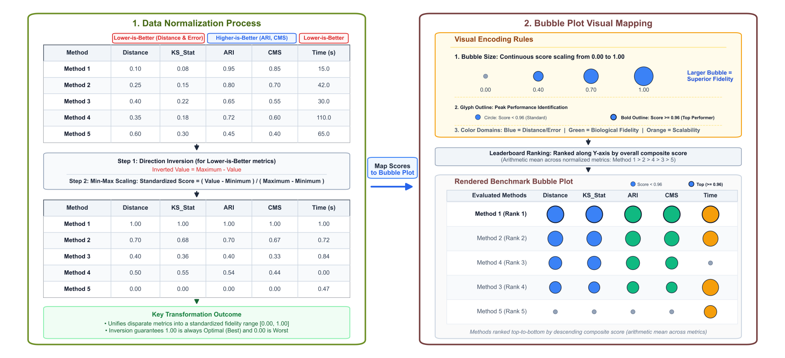
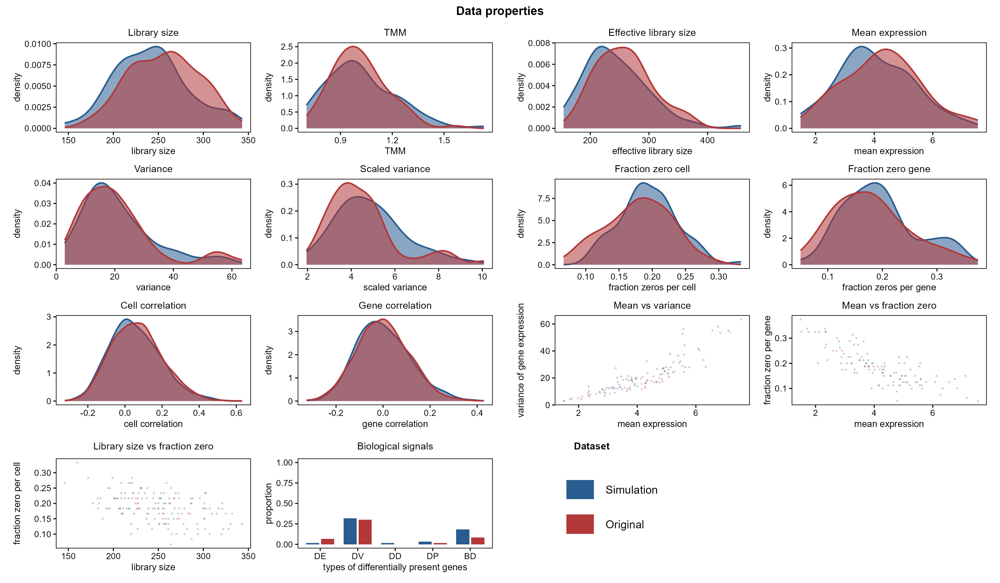
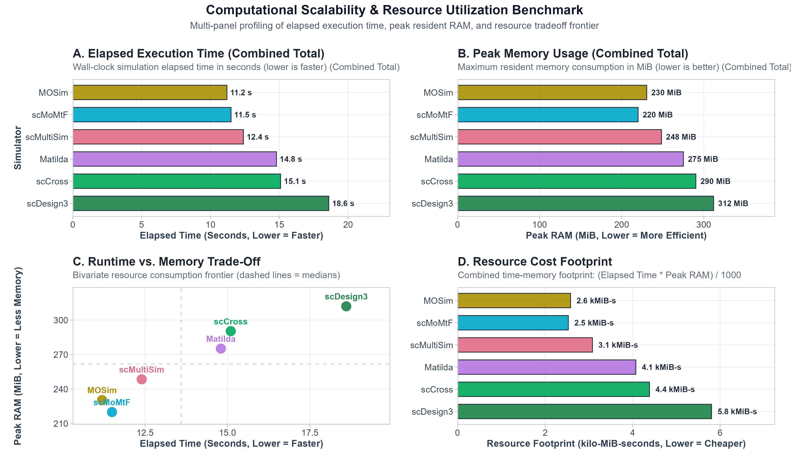
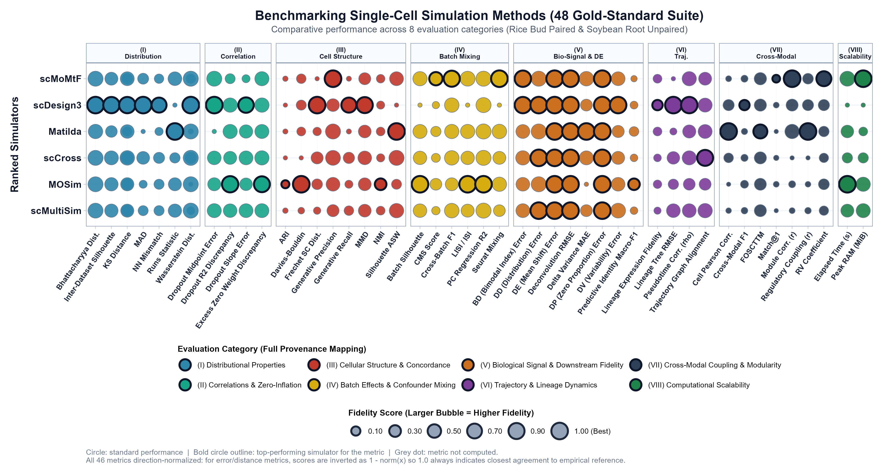
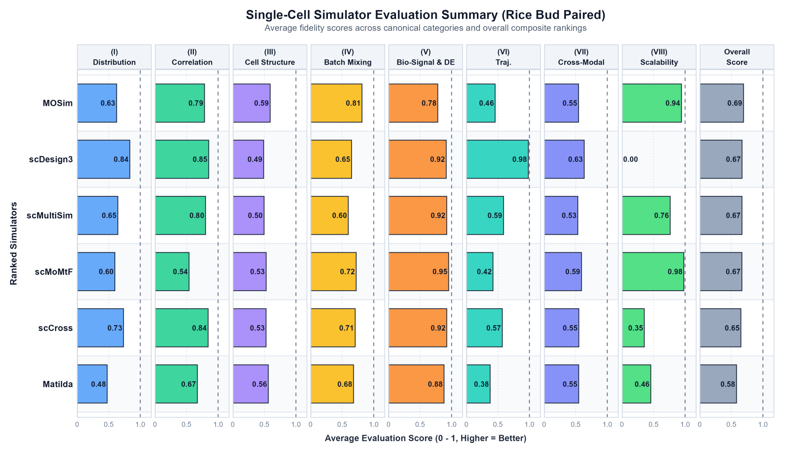
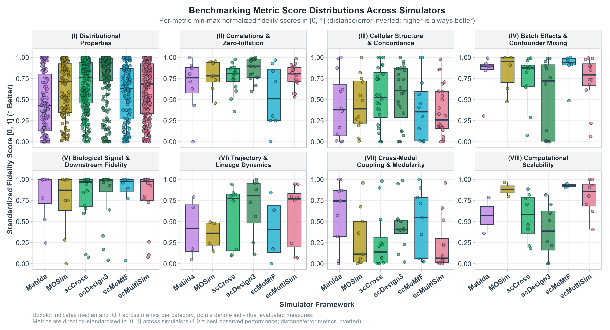
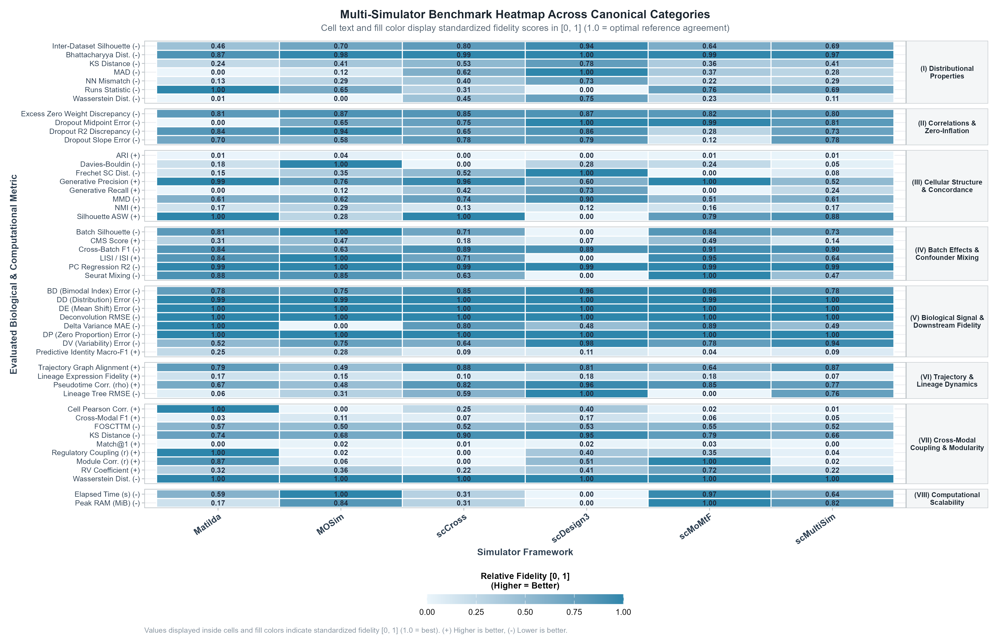
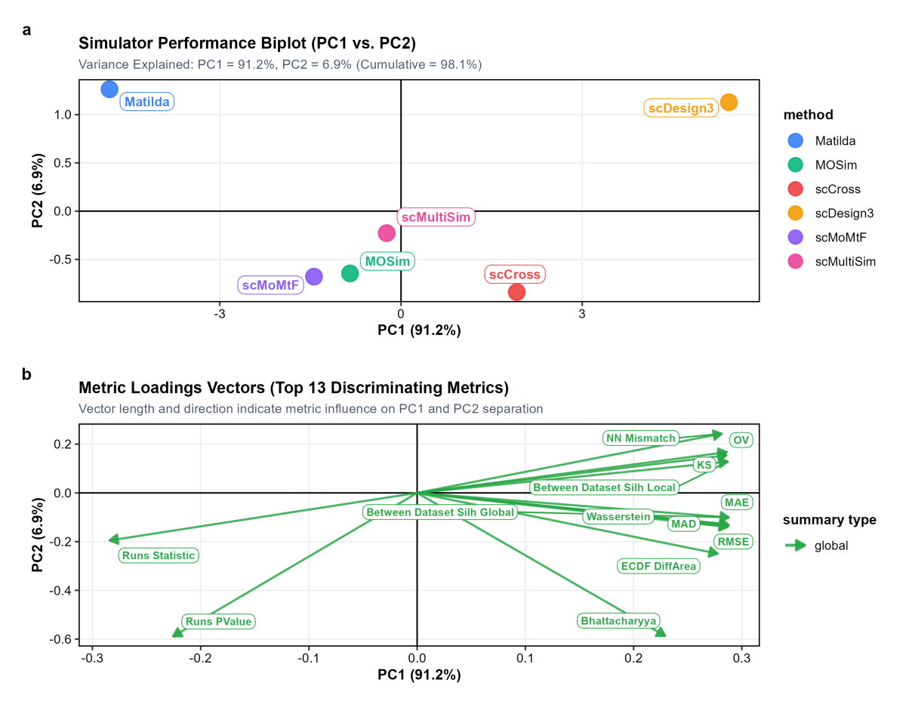

```{r knitr-setup, include = FALSE}
knitr::opts_chunk$set(
  collapse = TRUE,
  comment = "#>",
  fig.width = 7,
  fig.height = 5,
  warning = FALSE,
  message = FALSE
)
```

## 1. Introduction

Computer simulations of single-cell technologies—specifically single-cell RNA sequencing (**scRNA-seq**), single-cell ATAC sequencing (**scATAC-seq**), and **scRNA-seq + scATAC-seq multiomics**—are essential in bioinformatics for developing pipelines, optimizing analysis workflows, and evaluating statistical methods. A fundamental question for any benchmark is: *how realistically does the simulated data replicate genuine biological experiments?*

**`scSimEval`** provides a standardized, reference-based benchmarking framework computing **48 curated evaluation metrics across 8 foundational categories** (39 metrics for unimodal assays, up to 48 metrics for paired multiomics):

1. **Experimental reference data** (`ref_rna`, `ref_atac`)
2. **Simulated synthetic data** (`sim_rna`, `sim_atac`)
3. **Cell type annotations** (`cell_types`, optional)
4. **Batch or donor identifiers** (`batch_info`, optional)
5. **Computer resources** (Runtime in seconds and peak RAM in MiB)
6. **Developmental trajectories** (automatically inferred directly from count matrices)

```{r workflow-overview, echo=FALSE, fig.align='center', out.width='100%', fig.cap='**Figure 1: Unified benchmarking architecture of scSimEval.** The end-to-end framework ingests reference and simulated single-cell and multiomics count matrices with experimental metadata, evaluates 48 curated evaluation measures across eight biological and computational dimensions, standardizes scores via direction-aware normalization, and generates publication-grade comparative visualizations and leaderboards.'}
knitr::include_graphics("figures/workflow_diagram.png")
```

> **Supported Multiomics Modalities:** `scSimEval` natively supports two multiomics experimental designs:
> **Paired** (co-assays where RNA and ATAC are measured from identical cells, e.g. 10x Multiome, SHARE-seq) with full cross-modal coupling evaluation; and **Unpaired** (independent scRNA-seq and scATAC-seq from separate cells of the same tissue) with unimodal evaluation plus population-level cross-modal concordance metrics. See the dedicated [Multiomics vignette](demo-multiomics.html) for detailed multiomics workflows.

---

## 2. Input Data Formats and Metric Measurement Capacity

### 2.1 Input Data Formats & Metadata Requirements

`scSimEval` accepts standard single-cell count matrices and optional metadata:

1. **Count Matrices (`ref`, `sim`):**
   - **Dimensions:** Features (Genes or ATAC Peaks) in **rows** $\times$ Cells in **columns**.
   - **Data Types:** R sparse matrices (`dgCMatrix`), standard numeric matrices, `data.frame`, `SingleCellExperiment`, or `Seurat`.

2. **Cell-Type Annotations (`cell_types`, optional):**
   - Used for Category III clustering fidelity (ARI, NMI, Silhouette width) and Category V biological signal preservation.
   - Character vector or factor matching cell columns:
     ```r
     data(example_cell_types, package = "scSimEval")
     head(example_cell_types)
     # Cell_01 Cell_02 Cell_03 Cell_04 Cell_05 
     #   TypeA   TypeA   TypeA   TypeA   TypeA 
     ```

3. **Batch Annotations (`batch_info`, optional):**
   - Used for Category IV batch effect and confounder mixing metrics (CMS, Inverse Simpson's Index, PCR $R^2$, Batch Silhouette, Seurat mixing, cross-batch F1).
   - Character vector or factor matching cell columns:
     ```r
     data(example_batch_info, package = "scSimEval")
     head(example_batch_info)
     # Cell_01 Cell_02 Cell_03 Cell_04 Cell_05 
     #  Batch1  Batch2  Batch1  Batch2  Batch1 
     ```

4. **Exporting Annotations from Seurat or SingleCellExperiment:**
   ```r
   # From Seurat:
   cell_types <- as.character(Idents(seurat_obj))
   batch_info <- as.character(seurat_obj$batch)

   # From SingleCellExperiment:
   cell_types <- as.character(SummarizedExperiment::colData(sce)$cell_type)
   batch_info <- as.character(SummarizedExperiment::colData(sce)$batch)
   ```

### 2.2 Metric Measurement Capacity by Data & Metadata Mode

`scSimEval` automatically scales its evaluation depth based on the input matrices and metadata provided. The exact metric counts measured by the updated package across the built-in reference datasets (`example_scrna`, `example_scatac`, `example_rice_bud`, and `example_soybean_root`) are summarized below:

| Experiment Mode | Uploaded Inputs | Metrics Measured | Active Evaluation Categories & Scope |
| :--- | :--- | :---: | :--- |
| **Single-Cell** *(scRNA / scATAC)* | Count Matrix alone *(no metadata)* | **19 Metrics** *(21 with Scalability)* | **Cat I** (Distributional Properties: 7 metrics / 63 instances), **Cat II** (Correlations & Zeroes: 4 metrics), **Cat III** (Cellular Manifolds: 4 metrics), **Cat VI** (Trajectory: 4 metrics), and **Cat VIII** (Scalability: 2 metrics). |
| **Single-Cell** *(scRNA / scATAC)* | Matrix + Cell Types | **33 Metrics** | *Adds +12 metrics:* Unlocks **Cat III** (Clustering: ARI, NMI, Silhouette, Davies-Bouldin) and **Cat V** (Biological Signal: SimBench DE, DP, DV, DD, BD, predictive Macro-F1, deconvolution RMSE, delta variance). |
| **Single-Cell** *(scRNA / scATAC)* | Matrix + Batch Info | **27 Metrics** | *Adds +6 metrics:* Unlocks **Cat IV** (Batch Effects: Batch Silhouette, PCR $R^2$, CMS, ISI, Seurat mixing metric, cross-batch F1). |
| **Single-Cell** *(scRNA / scATAC)* | **Full Metadata** *(Matrix + Cell Types + Batch)* | **39 Metrics** | Unlocks the complete unimodal suite across **Categories I, II, III, IV, V, VI, and VIII**. |
| **Paired Multiomics** *(scRNA + scATAC - Rice Bud)* | RNA + ATAC Matrices alone | **33 Metrics** | Both unimodal distributions, correlations, manifolds, trajectories (172 instances) PLUS **Cat VII** (Paired Cross-Modal Coupling: FOSCTTM, Match@1, cell Pearson correlation, regulatory coupling correlation, $R_V$ coefficient, module fidelity, peak co-accessibility, network Jaccard, and Scalability). |
| **Paired Multiomics** *(scRNA + scATAC - Rice Bud)* | Matrices + Cell Types | **41 Metrics** | Unlocks Cat III clustering and Cat V biological signal fidelity across both modalities (180 instances). |
| **Paired Multiomics** *(scRNA + scATAC - Rice Bud)* | Matrices + Batch Info | **39 Metrics** | Unlocks Cat IV batch effects and confounder integration (178 instances). |
| **Paired Multiomics** *(scRNA + scATAC - Rice Bud)* | **Full Metadata** *(RNA + ATAC + Cell Types + Batch)* | **All 48 Metrics** | Complete multiomics benchmark suite across all 8 canonical categories (**Categories I–VIII**, 187 instances). |
| **Unpaired Multiomics** *(Independent cells - Soybean Root)* | RNA + ATAC Matrices alone | **27 Metrics** | Both unimodal distributions plus population-level cross-modal coupling (module preservation fidelity, peak co-accessibility fidelity, and Scalability; 166 instances). |
| **Unpaired Multiomics** *(Independent cells - Soybean Root)* | **Full Metadata** *(RNA + ATAC + Cell Types + Batch)* | **41 Metrics** | *Complete unpaired multiomics suite:* Unlocks cross-modal label transfer accuracy, network Jaccard overlap, cluster concordance, donor batch integration, and biological signals (180 instances). Cell-level pairing metrics (FOSCTTM, Match@1) are omitted because cells are independent. |

---

## 3. Score Normalization and Visual Mapping Workflow

In single-cell benchmarking, metrics operate on disparate scales and directions: statistical distances are near zero (lower is better), runtime is in seconds, peak memory is in MiB, and clustering accuracy ranges in $[-1, 1]$ (higher is better).

`scSimEval` resolves this through an automated **two-step score normalization pipeline**:

```{r score-norm-workflow, echo=FALSE, fig.align='center', out.width='100%', fig.cap='**Figure 2: Score normalization and visual mapping workflow in scSimEval.** Box 1 shows the two-step normalization: direction inversion for lower-is-better metrics followed by min-max scaling to a standard [0, 1] range. Box 2 illustrates visual mapping into bubble matrices, where bubble size reflects simulation quality and top performers are highlighted with bold circular outlines.'}

```

1. **Direction Inversion:** For metrics where smaller values indicate better simulations (e.g. KS distance, Wasserstein distance, RMSE, runtime, peak RAM), scores are inverted:
   $$\text{Inverted Value} = \text{Maximum} - \text{Value}$$
2. **Min-Max Scaling ($0.00$ to $1.00$):** Values are scaled so $1.00$ universally represents best observed performance:
   $$\text{Standardized Score} = \frac{\text{Value} - \text{Minimum}}{\text{Maximum} - \text{Minimum}}$$

In bubble matrix visualizations, **bubble size** directly reflects standardized quality, **bold circular outlines** highlight the top-performing simulator for each metric, and **category colors** organize the evaluation dimensions.

---

## 4. Installation and Quick Start

Install and load **`scSimEval`** from GitHub:

```r
if (!requireNamespace("devtools", quietly = TRUE)) install.packages("devtools")
devtools::install_github("kabilanbio/scSimEval")
library(scSimEval)
```

```{r setup, include=FALSE}
library(scSimEval)
```

`scSimEval` provides built-in reference datasets for instant testing:
* **`example_scrna`**: Empirical reference and simulated scRNA-seq count matrices ($60\text{ genes} \times 80\text{ cells}$) with cell types and batch annotations.
* **`example_scatac`**: Empirical reference and simulated scATAC-seq peak matrices ($60\text{ peaks} \times 80\text{ cells}$).
* **`example_rice_bud`**: Paired single-cell multiomics benchmark dataset of rice bud tissue (scRNA-seq + scATAC-seq from identical cells).
* **`example_soybean_root`**: Unpaired single-cell multiomics benchmark dataset of soybean root tissue (independent scRNA and scATAC cells).

```{r load-data}
data(example_scrna, package = "scSimEval")
data(example_scatac, package = "scSimEval")

cat("scRNA-seq dimensions:", dim(example_scrna$ref), "\n")
cat("scATAC-seq dimensions:", dim(example_scatac$ref), "\n")
cat("Cell types present:", levels(example_scrna$cell_types), "\n")
```

---

## 5. Evaluating Data Properties and Distributions (Categories I & II)

`evaluate_simulation_accuracy()` computes 1D and 2D distribution distances and zero-inflation patterns between reference and simulated matrices:

```{r unimodal-eval}
unimodal_res <- evaluate_simulation_accuracy(
  ref_data = example_scrna$ref,
  sim_data = example_scrna$sim,
  compute_bivariate = FALSE,
  verbose = FALSE
)

# Preview library size distribution metrics
lib_summary <- subset(unimodal_res$metrics_summary_table, Property == "library_size")
knitr::kable(head(lib_summary, 6), digits = 4, caption = "Library Size Statistical Distance Measures")
```

### 5.1 Comparative Distribution QC Plot (`plot_distribution_qc`)

`plot_distribution_qc()` generates a multi-panel layout comparing properties such as library size, mean expression, gene variance, zero proportions, and cell-cell correlations:

```{r plot-dist-qc-fig, echo=FALSE, fig.align='center', out.width='100%', fig.cap='**Figure 3: Comparative distribution QC layout.** Compares real biological data (warm brick red) and simulated data (steel blue) across single-cell distributional properties, mean-variance trends, and zero-inflation curves.'}

```

```r
plot_distribution_qc(
  ref_data   = example_scrna$ref,
  sim_data   = example_scrna$sim,
  title      = "Data Properties Quality Control",
  ref_name   = "Real Data",
  sim_name   = "Simulated Data",
  cell_types = example_scrna$cell_types
)
```

---

## 6. Evaluating Cell Clustering and Group Structure (Category III)

`evaluate_clustering_metrics()` assesses whether simulated data preserve unsupervised cluster separability and ground-truth cell-type boundaries:

```{r clustering-eval}
clust_res <- evaluate_clustering_metrics(
  data = example_scrna$sim,
  cell_types = example_scrna$cell_types,
  ref_data = example_scrna$ref
)

cat("Average Silhouette Width:", round(clust_res$silhouette, 4), "\n")
cat("Davies-Bouldin Index:", round(clust_res$davies_bouldin, 4), "\n")
cat("Adjusted Rand Index (ARI):", round(clust_res$ARI, 4), "\n")
cat("Normalized Mutual Information (NMI):", round(clust_res$NMI, 4), "\n")
```

---

## 7. Evaluating Batch Effects and Technical Confounders (Category IV)

`evaluate_batch_metrics()` checks whether simulated multi-batch data properly capture technical batch variations without obscuring biological signals:

```{r batch-eval}
batch_res <- evaluate_batch_metrics(
  data = example_scrna$sim,
  batch_info = example_scrna$batch_info,
  cell_types = example_scrna$cell_types,
  verbose = FALSE
)

cat("Batch Shannon Entropy:", round(batch_res$shannon_entropy, 4), "\n")
cat("PC Regression R2 (PCR):", round(batch_res$pcr_r2, 4), "\n")
cat("Cross-Batch Transfer Accuracy:", round(batch_res$cross_batch_accuracy, 4), "\n")
```

---

## 8. Evaluating Cell Lineages and Trajectory Dynamics (Category VI)

`scSimEval` automatically infers differentiation pseudotime directly from count matrices and evaluates lineage fidelity without requiring external pseudotime labels:

```{r trajectory-eval}
traj_res <- evaluate_trajectory_metrics(
  ref_data = example_scrna$ref,
  sim_data = example_scrna$sim,
  cell_types_ref = example_scrna$cell_types,
  cell_types_sim = example_scrna$cell_types
)

cat("Pseudotime Spearman Correlation:", round(traj_res$pseudotime_correlation, 4), "\n")
cat("Lineage Tree Branch Height RMSE:", round(as.numeric(traj_res$tree_height_rmse), 4), "\n")
```

---

## 9. Evaluating Biological Signals and Marker Genes (Category V)

`evaluate_deg_fidelity()` evaluates whether simulated counts preserve true differential expression signals (SimBench DE, DP, DV, DD, BD), cell-type classification accuracy, and top-DEG Jaccard overlap:

```r
deg_res <- evaluate_deg_fidelity(
  ref_data      = example_scrna$ref,
  sim_data      = example_scrna$sim,
  ref_celltypes = example_scrna$cell_types,
  sim_celltypes = example_scrna$cell_types,
  top_n_de      = 50
)
knitr::kable(head(deg_res$deg_summary_table, 6), digits = 4)
```

---

## 10. Evaluating Computational Scalability (Category VIII)

`plot_scalability_benchmark()` generates a comprehensive dashboard comparing runtime, memory usage (in **MiB**), runtime-memory Pareto frontiers, and cell throughput:

```{r plot-scalability-fig, echo=FALSE, fig.align='center', out.width='100%', fig.cap='**Figure 4: Computational scalability benchmark suite.** Multi-panel dashboard comparing execution runtime (seconds), peak RAM (MiB), runtime-memory tradeoffs, and throughput across simulation methods.'}

```

```r
data(example_rice_bud, package = "scSimEval")
plot_scalability_benchmark(example_rice_bud$scalability_benchmarks)
```

---

## 11. Master Multiomics Pipeline: `evaluate_multiomics_accuracy`

The flagship pipeline function `evaluate_multiomics_accuracy()` executes the complete benchmark across all 8 canonical categories in a single call:

```r
data(example_rice_bud, package = "scSimEval")

master_eval <- evaluate_multiomics_accuracy(
  ref_multi = list(rna = example_rice_bud$reference$rna, atac = example_rice_bud$reference$atac),
  sim_multi = list(rna = example_rice_bud$simulated$scMultiSim$rna, atac = example_rice_bud$simulated$scMultiSim$atac),
  cell_types = example_rice_bud$reference$cell_types,
  batch_info = example_rice_bud$reference$batches,
  pairing = "paired",
  elapsed_time = 12.4,
  memory_mb = 248,
  verbose = FALSE
)

# Tidy summary table containing all 48 curated evaluation metrics
head(master_eval$metrics_summary_table)
```

> **HPC Multi-Core Parallelization:** Specifying `threads = 4` or `threads = 8` parallelizes 2D distribution tests and cross-modal peak-to-gene correlations via `BiocParallel`.

---

## 12. Visualization Suite

`scSimEval` provides built-in visualization functions generating publication-ready figures (supporting 600 DPI export).

### 12.1 Multi-Dimensional Benchmarking Bubble Matrix (`plot_benchmark_bubble_matrix`)

The flagship visualization **`plot_benchmark_bubble_matrix()`** summarizes multi-simulator performance across the 8 evaluation categories. Bubble sizes represent standardized simulation quality ($0.00$ to $1.00$; larger is better), and top performers for each metric are highlighted with bold circular outlines:

```{r plot-bubble-matrix-fig, echo=FALSE, fig.align='center', out.width='100%', fig.cap='**Figure 5: Flagship multi-dimensional benchmarking bubble matrix.** Ranks simulation methods top-to-bottom across the 8 evaluation categories based on the 48 curated evaluation metric analysis. Bubble sizes indicate standardized fidelity scores ($0.00$ to $1.00$), and top performers for each metric are highlighted with bold circular outlines.'}

```

```r
# Render benchmark bubble matrix
plot_benchmark_bubble_matrix(
  data = demo_benchmark_results,
  bubble_size_range = c(2, 7.5),
  title = "Benchmarking Single-Cell Simulation Methods (48 Curated Evaluation Suite)",
  subtitle = "Comparative performance across 8 evaluation categories"
)
```

### 12.2 Evaluation Summary Horizontal Bar Matrix (`plot_evaluation_summary`)

`plot_evaluation_summary()` ranks candidate simulators from best to worst and displays average scores across all evaluation categories:

```{r eval-summary-bars, echo=FALSE, fig.align='center', out.width='100%', fig.cap='**Figure 6: Executive evaluation summary horizontal bar matrix.** Ranks simulators across the 8 categories and displays overall composite performance with exact score annotations.'}

```

```r
# Extract method leaderboard
leaderboard <- compute_method_leaderboard(demo_benchmark_results)
knitr::kable(leaderboard, digits = 4, caption = "Simulator Performance Leaderboard")
```

### 12.3 Metric Score Distributions Across Categories (`plot_metric_boxplots`)

`plot_metric_boxplots()` displays score distributions and individual metric data points across the 8 categories:

```{r plot-boxplots-fig, echo=FALSE, fig.align='center', out.width='100%', fig.cap='**Figure 7: Metric score distributions across the 8 categories.** Displays standardized scores ($[0, 1]$, higher is better) with individual data points and boxplots across candidate simulators.'}

```

### 12.4 Complete Benchmark Heatmap (`plot_metric_heatmap`)

`plot_metric_heatmap()` displays exact numeric values for every metric inside each cell:

```{r plot-heatmap-fig, echo=FALSE, fig.align='center', out.width='100%', fig.cap='**Figure 8: Complete benchmark metric heatmap.** Displays exact unnormalized raw scores in bold text inside every cell, grouped across the 8 evaluation categories.'}

```

### 12.5 Dimension Reduction and Ordination Plots (PCA & MDS)

`plot_metric_pca()` and `plot_metric_mds()` project simulation methods into 2D metric ordination space:

```{r plot-pca-cat1, echo=FALSE, fig.align='center', out.width='85%', fig.cap='**Figure 9: Principal Component Analysis (PCA) ordination of simulation methods.** Projects simulators based on their metric profiles, showing algorithmic affinities and key discriminating metric vectors.'}

```

### 12.6 Cell Embeddings (t-SNE, UMAP, & PCA) and Low-Dimensional Quality Metrics

`scSimEval` enables visual and quantitative inspection of whether simulated cells faithfully recover biological manifolds:

```{r cell-embeddings-demo, eval=TRUE}
# Compute low-dimensional embeddings
emb_data <- compute_dataset_embeddings(
  reference   = example_scrna$ref,
  simulated   = list("Splatter" = example_scrna$sim),
  reduction   = "pca",
  n_pcs       = 10,
  cell_types  = example_scrna$cell_types,
  batch       = example_scrna$batch_info
)

# Quantitative low-dimensional quality metrics
quality_table <- compute_embedding_quality_metrics(emb_data)
knitr::kable(quality_table, digits = 4, caption = "Quantitative Low-Dimensional Quality Metrics")
```

---

## 13. Multi-Dataset and Multi-Method Benchmarking

For studies evaluating simulators across multiple biological cohorts or tissues, `scSimEval` provides automated multi-dataset tools:

```r
# Combine independent benchmark sessions into a unified multi-dataset object
multi_bench <- combine_benchmark_results(
  benchmark_rice,
  benchmark_soybean,
  dataset_names = c("Rice Bud (Paired)", "Soybean Root (Unpaired)")
)

# Compute cross-dataset average fidelity leaderboard
compute_method_leaderboard(multi_bench)

# Step-by-step interactive figure zoom (+30% magnification)
p_zoomed <- zoom_plot(p_bubble, zoom = 1.3)
```

---

## 14. Interactive Web Application (Shiny Studio)

For researchers who prefer a graphical interface, `launch_scSimEval_app()` opens the interactive Benchmarking Studio:

```r
# Launch interactive Shiny studio in default browser
launch_scSimEval_app()
```

The studio is organized into 7 modular tabs:
1. **Home**: Overview of the 48 curated evaluation measures and interactive tour.
2. **Data Hub**: 4 ingestion modes (Demo benchmark data, Single-cell evaluation, Multi-omics co-assays, and Upload saved results) with QC inspection and automated SLURM script generation.
3. **Comparative Bubble Matrix & Leaderboard**: 48-metric matrix with multi-dataset selectors, step-by-step zoom, podium rankings, and standalone R script download.
4. **Visualizations**: Diagnostic panels for Evaluation Summary, Distribution QC, Scalability, Metric Boxplots, Heatmaps, PCA/MDS, and Cell Embeddings.
5. **Results & Export**: Dual-value table reporting (`Score_Raw` and normalized `Score`) with Excel, CSV, RDS, and ZIP export handlers.
6. **Help & Manual**: Formula glossary, hardware recommendations, and input templates.
7. **Logs & Diagnostics**: Real-time event streaming and diagnostic tracebacks.

---

## 15. Supported Multiomics Data Types and Metric Compatibility

### 15.1 Two Experimental Designs

`scSimEval` strictly evaluates single-cell multiomics simulations according to experimental design:

| Data Type | Definition | Example Technologies |
|---|---|---|
| **Paired** | RNA and ATAC measured from **exactly the same cells** | 10x Multiome, SHARE-seq, SNARE-seq |
| **Unpaired** | RNA and ATAC measured from **separate cells** of the same tissue | Independent 10x scRNA-seq + scATAC-seq experiments |

### 15.2 Metric Compatibility by Data Type

| Evaluation Dimension & Metric Group | Paired Multiomics | Unpaired Multiomics | Unimodal (scRNA / scATAC) |
|---|:---:|:---:|:---:|
| **(I) Distributional Properties** (Wasserstein, KS, MAD, Bhattacharyya, Runs test, NN mismatch, Silhouette) | ✅ (All 7) | ✅ (All 7) | ✅ (All 7) |
| **(II) Correlations & Zero-Inflation** (Dropout midpoint/slope error, $R^2$ discrepancy, excess zero weights) | ✅ (All 4) | ✅ (All 4) | ✅ (All 4) |
| **(III) Cellular Structure & Concordance** (ARI, NMI, Silhouette width, Davies-Bouldin, MMD, Fréchet SC, Precision, Recall) | ✅ (All 8) | ✅ (All 8) | ✅ (All 8) |
| **(IV) Batch Effects & Confounder Mixing** (Batch Silhouette, PCR $R^2$, CMS, ISI, Seurat mixing, Cross-batch F1) | ✅ (All 6) | ✅ (All 6) | ✅ (All 6) |
| **(V) Biological Signal & Downstream Fidelity** (SimBench DE, DP, DV, DD, BD, Macro-F1, Deconvolution RMSE, Delta Variance) | ✅ (All 8) | ✅ (All 8) | ✅ (All 8) |
| **(VI) Trajectory & Lineage Dynamics** (Pseudotime correlation, Tree height RMSE, Graph alignment, Lineage dynamics) | ✅ (All 4) | ✅ (All 4) | ✅ (All 4) |
| **(VII) Cross-Modal Modularity & Overlap** (Module preservation fidelity, Peak co-accessibility, Label transfer, Network Jaccard) | ✅ (All 4) | ✅ (All 4) | ❌ *(Single modality)* |
| **(VII) Joint Cell-Level Coupling** (FOSCTTM, Match@1, Cross-modal generation PCC, Regulatory coupling, $R_V$ coefficient) | ✅ (All 5) | ❌ *(Unlinked cells)* | ❌ *(Single modality)* |
| **(VIII) Computational Scalability** (Elapsed time seconds, Peak memory MiB) | ✅ (Both 2) | ✅ (Both 2) | ✅ (Both 2) |
| **Total Evaluation Capacity** | **All 48 Metrics** | **41 Metrics** | **39 Metrics** |
| **Direct Pipeline Support** | `evaluate_multiomics_accuracy(..., pairing="paired")` | `evaluate_multiomics_accuracy(..., pairing="unpaired")` | `evaluate_simulation_accuracy()` |

### 15.3 Recommended Workflows by Data Type

**Paired data** — run the master multiomics pipeline directly:
```r
evaluate_multiomics_accuracy(
  ref_multi = list(rna = ref_rna, atac = ref_atac),
  sim_multi = list(rna = sim_rna, atac = sim_atac),
  cell_types = cell_types,
  batch_info = batch_info,
  pairing = "paired"
)
```

**Unpaired data** — run the master multiomics pipeline with `pairing = "unpaired"`:
```r
evaluate_multiomics_accuracy(
  ref_multi = list(rna = ref_rna, atac = ref_atac),
  sim_multi = list(rna = sim_rna, atac = sim_atac),
  cell_types = list(rna = rna_cell_types, atac = atac_cell_types),
  batch_info = list(rna = rna_batches, atac = atac_batches),
  pairing = "unpaired"
)
```

---

## 16. Large-Scale Multi-Dataset Benchmarking on HPC Clusters

When evaluating simulation tools across multiple biological cohorts (e.g. 6 simulators across 16 datasets), `benchmark_simulation_suite()` optimizes memory management and cluster multithreading:

```r
# Run high-performance multi-dataset benchmark
mset_bench <- benchmark_simulation_suite(
  datasets    = refs,
  simulators  = sims,
  threads     = 8,
  auto_sparse = TRUE,
  run_gc      = TRUE,
  save_path   = "my_multidataset_benchmark.rds"
)

# Plot consolidated bubble matrix
plot_benchmark_bubble_matrix(mset_bench)
```

---

## 17. Summary

`scSimEval` provides a unified, objective, and reference-based evaluation framework for benchmarking single-cell and multiomics simulation methods. With **48 curated evaluation metrics across 8 foundational categories**, automated score normalization, and publication-quality visualizations, it enables researchers to rigorously validate simulation tools with confidence.

---

## 18. Authors and Maintainers

* **Kabilan S** (Ph.D Student and Maintainer, ICAR-IASRI) — `kabilan151414@gmail.com`
* **Dr. Dwijesh Chandra Mishra** (Author & Thesis Guide, ICAR-IASRI) — `dwij.mishra@gmail.com`
* **Dr. Shashi Bhushan Lal** (Author, ICAR-IASRI) — `sblall16@gmail.com`
* **Dr. Sudhir Srivastava** (Author, ICAR-IASRI) — `sudhir0401bm@gmail.com`
* **Dr. Krishna Kumar Chaturvedi** (Author, ICAR-IASRI) — `kkcchaturvedi@gmail.com`
* **Dr. Sharanbasappa** (Contributor, ICAR-IASRI) — `smadival509@gmail.com`

* **GitHub Repository:** [https://github.com/kabilanbio/scSimEval](https://github.com/kabilanbio/scSimEval)
* **Bug Reports & Issues:** [https://github.com/kabilanbio/scSimEval/issues](https://github.com/kabilanbio/scSimEval/issues)

---

## 19. Session Information

```{r session-info}
sessionInfo()
```
