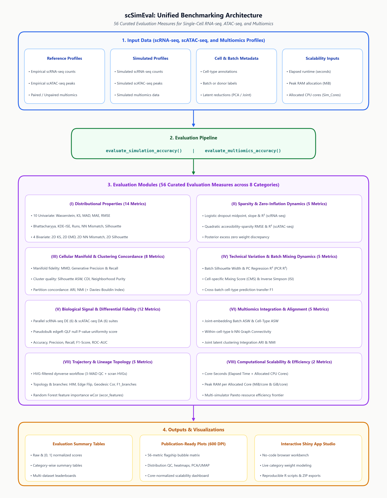

```{r knitr-setup, include = FALSE}
knitr::opts_chunk$set(
  collapse   = TRUE,
  comment    = "#>"
)
```

## Welcome to scSimEval Shiny Studio

The **scSimEval Shiny Studio** is an easy-to-use, point-and-click web application included inside the `scSimEval` R package. It compares **simulated single-cell or multiomics data** against **real reference data** and scores each simulator from **0.00 (lowest)** to **1.00 (best)** across **56 quality measures** in **8 categories**—without requiring you to write complex R scripts.

### Launch the App in R

```r
library(scSimEval)
launch_scSimEval_app()
```

### Get Started in 3 Easy Steps (Takes 30 Seconds)

1. **Step 1 — Load Data (`Data Hub`):** Open the **Data Hub** tab and click to load one of the built-in example datasets—**Rice Bud** (paired dataset, 8 tissues, 6 simulators) or **Soybean Root** (unpaired dataset, 7 tissues, 3 simulators)—or upload your own `Seurat` / `SingleCellExperiment` `.rds` files.
2. **Step 2 — Compare Simulators (`Comparative Bubble Matrix`):** Open **Comparative Bubble Matrix** to see all simulators ranked from best to worst in the **Comparative Bubble Matrix Figure** and **Fidelity Leaderboard**.
3. **Step 3 — View Charts & Export (`Visualizations` / `Benchmark Results & Export`):** Explore the 8 diagnostic plot tabs in **Visualizations** or download your full results table in **Benchmark Results & Export**.

---

## 1. How scSimEval Works (4 Simple Steps)

<p align="center">
  
</p>

1. **Step 1 — Input Your Data:** Provide one real reference dataset and one or more simulated datasets (`scRNA-seq`, `scATAC-seq`, or `Single-Cell Multiomics`) saved as `Seurat` or `SingleCellExperiment` `.rds` files.
2. **Step 2 — Measure Similarity:** `scSimEval` automatically calculates up to **56 quality measures** across **8 evaluation categories** (count distributions, sparsity, cell clusters, batch mixing, DEGs/DARs, multiomics integration, developmental trajectories, and speed/RAM).
3. **Step 3 — Convert to 0.00–1.00 Scores:** Every metric is converted onto a simple **$[0.00, 1.00]$ scale** where **$1.00$ = Best** and **$0.00$ = Lowest**, while also keeping the original raw values (`Score_Raw`).
4. **Step 4 — Rank, Plot & Export:** Simulators are ranked by their composite **Overall Score** and displayed in publication-ready bubble matrices, leaderboards, 8 diagnostic plot panels, and downloadable standalone R scripts.

---

## 2. What Do the 8 Evaluation Categories Measure? (56 Metrics)

You do not need to configure metrics manually—`scSimEval` automatically selects the right metrics based on the data and metadata you provide:

| Category | # Metrics | Data Needed | What Question Does It Answer? (and What It Measures) |
| :--- | :---: | :--- | :--- |
| **I. Distributional Properties** | **14** | Count matrix only | **Do the simulated cell and gene/peak count distributions match real data?**<br>10 univariate & 4 bivariate distributional similarity measures (Wasserstein, KS, MAD, Bhattacharyya, Runs test, NN mismatch, Silhouette, 2D KS, 2D EMD, 2D NN mismatch, 2D Silhouette) across 7 cell-level, 7 feature-level, and 4 bivariate properties. |
| **II. Sparsity & Zero-Inflation Dynamics** | **5** | Count matrix only | **Are zero counts and dropout rates realistic across genes/peaks and cells?**<br>Logistic dropout curve fidelity (midpoint error $x_0$, transition slope error $k$, goodness-of-fit $R^2$), quadratic accessibility-sparsity RMSE & $R^2$ (scATAC-seq), and excess zero proportion difference. |
| **III. Cellular Manifold & Clustering Concordance** | **8** | Counts + optional `cell_type` | **Do simulated cells form the right cell-type clusters and neighborhood structures?**<br>Maximum Mean Discrepancy (MMD), Generative Precision & Recall, Average Silhouette Width (ASW), Clustering Deviation Index (CDI), Neighborhood Purity, Adjusted Rand Index (ARI), and Normalized Mutual Information (NMI). |
| **IV. Technical Variation & Batch Mixing Dynamics** | **5** | Needs `batch` column | **Are technical batch differences reproduced properly across batches?**<br>Batch Silhouette Width, Principal Component Regression (PCR $R^2$), Cell-Specific Mixing Score (CMS), Inverse Simpson's Index (ISI), and Cross-Batch F1 Score. |
| **V. Biological Signal & Differential Fidelity** | **12** | Needs `cell_type` column | **Can we still detect true marker genes (DEGs) and accessible chromatin peaks (DARs)?**<br>Pseudobulk `edgeR-QLF` differential testing for scRNA-seq DE (6 metrics) and scATAC-seq DA (6 metrics): p-value uniformity, accuracy, precision, recall, F1-score, and ROC-AUC. |
| **VI. Multiomics Integration & Alignment** | **5** | Paired RNA + ATAC | **Do simulated RNA and ATAC modalities align and integrate well together?**<br>Joint-embedding integration quality: Batch ASW, Cell-Type ASW, k-NN Graph Connectivity, Integration ARI, and Integration NMI. |
| **VII. Trajectory & Lineage Topology** | **5** | scRNA-seq counts | **Are cell developmental paths, branches, and trajectory genes preserved?**<br>HVG-filtered `dynverse` workflow on scRNA-seq: HIM topology similarity, edge-flip similarity, geodesic distance correlation, branch assignment F1 (`F1_branches`), and Random Forest feature importance correlation (`wcor_features`). |
| **VIII. Computational Scalability & Efficiency** | **2** | Runtime & RAM inputs | **How fast and memory-light is each simulator?**<br>Core-normalized runtime (`core_seconds`) and memory per allocated core (`memory_per_core_mib`), alongside wall-clock elapsed time (`s` / `min`) and total peak RAM (`MiB` / `GiB`). |

### How Many Metrics Will Run on My Data?

* **scRNA-seq only (up to 45 metrics):** `29 / 45` with counts only • `40 / 45` with `cell_type` • **all `45 / 45`** with `cell_type + batch`.
* **scATAC-seq only (up to 32 metrics):** `16 / 32` with counts only • `27 / 32` with `cell_type` • **all `32 / 32`** with `cell_type + batch`.
* **Paired Multiomics (up to 56 metrics):** `35 / 56` with counts only • `49 / 56` with `cell_type` • **all `56 / 56`** with `cell_type + batch` (or `30 / 56` to `51 / 56` in **Unpaired Multiomics**).

---

## 3. How to Read the Scores (0.00 to 1.00)

1. **Higher is Always Better:** For error, distance, runtime, or memory metrics where smaller raw numbers are better, `scSimEval` automatically flips them so **a higher score always means better performance**.
2. **Scaled From 0.00 to 1.00:** All metrics are scaled between **$0.00$** (lowest-performing simulator) and **$1.00$** (top-performing simulator) so metrics with different physical units can be compared side by side.
3. **Category & Overall Score:** Metrics are averaged into Category Scores, and the **Overall Score** is the average (or custom weighted sum in the Leaderboard) across categories.
4. **Raw + Scaled Saved:** Both the original unnormalized measurement (`Score_Raw`) and the normalized $[0, 1]$ score (`Score`) are stored in the results table.

---

## 4. Quick Guide to the 8 Tabs in the Top Menu

### Tab 1 — Home
Provides a quick overview of `scSimEval`, summary counts for all 8 evaluation categories and 56 metrics, and quick-jump buttons to start exploring the application.

### Tab 2 — Data Hub
The central workspace for loading example data, uploading your own `.rds` datasets, or loading saved benchmark results. In the left sidebar, choose one of four **Data Modes**:

1. **Mode 1 — `1. scRNA-seq datasets`:**
   * **Load Example scRNA-seq Data:** Choose between **Rice Bud (Paired, 8 tissues, 6 Simulators)** or **Soybean Root (Unpaired, 7 tissues, 3 Simulators)** and click **Load Example scRNA-seq Data**.
   * **Custom scRNA-seq Evaluation:** Upload 1 or more reference `Seurat` / `SingleCellExperiment` `.rds` objects and simulated `.rds` objects, enter runtime (`s` or `min`), peak RAM (`MiB` or `MB`), and CPU cores used, and click **Calculate Single-Cell Metrics** (or **Download R Script** to run offline).
2. **Mode 2 — `2. scATAC-seq datasets`:**
   * **Load Example scATAC-seq Data:** Load the **Rice Bud** (8 tissues, 6 simulators) or **Soybean Root** (7 tissues, 3 simulators) scATAC-seq example datasets with one click.
   * **Custom scATAC-seq Evaluation:** Upload reference and simulated chromatin accessibility `.rds` objects and click **Calculate scATAC-seq Metrics**.
3. **Mode 3 — `3. Single-Cell Multiomics datasets`:**
   * **Assay Type:** Switch between **Paired (Same Cells, 10x / SHARE-seq)** and **Unpaired (Independent Cells)**.
   * **Load Example Multiomics Data:**
     * In **Paired** mode: Click **Load Rice Bud Example (Paired, 6 Simulators)** to load the *Oryza sativa* Rice Bud benchmark (8 tissues, 6 simulators: `scMultiSim`, `scDesign3`, `MOSim`, `scCross`, `scMoMtF`, `Matilda`).
     * In **Unpaired** mode: Click **Load Soybean Root Example (Unpaired, 3 Simulators)** to load the *Glycine max* Soybean Root benchmark (7 tissues, 3 simulators: `scMultiSim`, `scDesign3`, `scCross`).
   * **Custom Multiomics Evaluation:** Upload reference RNA & ATAC `.rds` objects and simulated RNA & ATAC `.rds` objects, then click **Calculate Multiomics Metrics**.
4. **Mode 4 — `4. Upload Saved Results (.rds / .csv)`:**
   * Load a previously saved `scSimEval` benchmark result file (`.rds` or `.csv`) to immediately view all leaderboards, bubble matrices, and diagnostic plots without re-running evaluations. Check **Add to current benchmark results** to combine multiple datasets.

Inside the **Data Hub** main panel, three sub-tabs let you:
* **Upload & Configure Data:** Upload `.rds` files and enter simulator runtime, RAM, and core counts.
* **View Uploaded Data:** Preview the uploaded count matrices and cell/feature dimensions.
* **Dataset properties:** Inspect a QC summary table (cells, genes/peaks, sparsity %, library size) across all uploaded datasets.

### Tab 3 — Comparative Bubble Matrix
Contains two sub-tabs for ranking and comparing simulators:

1. **Sub-Tab 1 — Comparative Bubble Matrix Figure:**
   * **Bars on the left** display the Overall Score and the 8 Category Scores.
   * **Circles on the right** display individual metrics (larger circle = better $[0, 1]$ score; bold black outline = best-performing simulator for that metric).
   * Filter by **Dataset** (or Cross-Dataset Average), **Modality** (All, RNA-Specific, ATAC-Specific, or Multiomics), or **Category**, use the interactive zoom bar (`+`, `-`, slider, `Fit`, `100%`, `Fullscreen`), and download 600 DPI JPEG, vector PDF, or a standalone reproducible R script.
2. **Sub-Tab 2 — Fidelity Leaderboard:**
   * Displays simulator ranking podium cards, category score breakdowns, multi-axis radar/star charts, and interactive **Category Weight Sliders** so you can customize category weights for your biological use case.

### Tab 4 — Visualizations (8 Diagnostic Sub-Tabs)
Eight dedicated diagnostic panels—each equipped with interactive zoom/pan controls, dataset & modality filters, 600 DPI image export, and a **Download Standalone R Script** button:

1. **1. Evaluation Summary:** Horizontal bar charts ranking simulators across Overall Score and all 8 Categories (toggle between Normalized $[0, 1]$ and Raw values).
2. **2. Distribution QC:** Quantile-Quantile (Q-Q) alignment plots and 1D/2D density curves comparing real vs. simulated cell-level, feature-level, and bivariate properties.
3. **3. Metric Heatmap:** Color-coded matrix of Simulators $\times$ Metrics with customizable dimensions and raw/normalized value display.
4. **4. Metric Plots:** Individual metric bar charts and category-level score distribution boxplots.
5. **5. PCA Ordination:** 2D Principal Component Analysis biplot showing how similar simulators are in metric space.
6. **6. MDS Metric Space:** Multidimensional Scaling map of simulator performance similarity.
7. **7. Cell Embeddings (UMAP, t-SNE & PCA):** Side-by-side 2D cell embeddings comparing real reference cells and simulated cells, accompanied by quantitative embedding fidelity metrics.
8. **8. Scalability Benchmark:** Hardware-aware execution time (`s`, `min`, or `Core-Seconds`) and memory (`MiB`, `GiB`, `MiB/core`, or `GiB/core`) trade-off charts.

### Tab 5 — Benchmark Results & Export
Search, filter, and sort all computed raw (`Score_Raw`) and normalized $[0, 1]$ (`Score`) values in an interactive table, and download the complete benchmark session as an `.rds` file for reproducible sharing.

### Tab 6 — Help & Getting Started
In-app beginner's guide covering the 3-step quick start, zoomable workflow diagrams, plain-English category descriptions, tab guide, and `.rds` data preparation snippets.

### Tab 7 — Logs
Live diagnostic console displaying real-time progress messages, warning/error counters, system CPU/RAM information, and a downloadable `.txt` execution log.

### Tab 8 — Contact
Profiles and contact details for the development team at the Division of Agricultural Bioinformatics, ICAR-IASRI, New Delhi, along with package citation information and GitHub issue links.

---

## 5. How to Prepare Your Own Data (`.rds` Files)

When uploading your own datasets in **Data Hub**, provide standard R `.rds` files containing a `Seurat` or `SingleCellExperiment` object with raw counts stored in the `counts` layer/assay (genes or peaks $\times$ cells):

```r
# 1. Save your Reference and Simulated objects as .rds
saveRDS(ref_obj, "reference.rds")
saveRDS(sim_obj, "splatter_sim.rds")

# 2. Add Cell Types (Optional — unlocks ARI, NMI, and DEG/DAR metrics)
# For Seurat:
obj$cell_type <- obj$seurat_clusters
# For SingleCellExperiment:
SummarizedExperiment::colData(sce)$cell_type <- sce$label

# 3. Add Batches (Optional — unlocks Category IV Batch Effect metrics)
# For Seurat:
obj$batch <- obj$orig.ident
# For SingleCellExperiment:
SummarizedExperiment::colData(sce)$batch <- sce$Batch
```

### Recommended Computer Specs

* **Small datasets ($< 5,000$ cells):** 8 GB RAM, 4 CPU cores (~1–2 min per simulator).
* **Medium datasets ($5,000 \text{ – } 25,000$ cells):** 16 GB RAM, 8 CPU cores (~3–6 min per simulator).
* **Large / Multiomics ($> 25,000$ cells):** 32+ GB RAM, 8–16 CPU cores.
* **Tip:** For large multi-simulator benchmarks, click **Download R Script** in **Data Hub** to run the evaluation offline on a workstation or HPC cluster, then upload the saved `.rds` file in **Data Hub (Mode 4)** for instant visualization!

---

## 6. R Function Cross-Reference

Every view in the **scSimEval Shiny Studio** corresponds directly to an exported R function in `scSimEval`:

| Shiny Studio Module | Package Function | Primary Output |
| :--- | :--- | :--- |
| Data Hub → Single-Cell (`scRNA` / `scATAC`) | `evaluate_simulation_accuracy()` | Unimodal benchmark results |
| Data Hub → Multiomics (`RNA + ATAC`) | `evaluate_multiomics_accuracy()` | Multiomics benchmark results |
| Data Hub → Merge Datasets | `combine_benchmark_results()` | Combined multi-dataset object |
| Comparative Bubble Matrix → Figure | `plot_benchmark_bubble_matrix()` | Ranked multi-metric bubble matrix |
| Comparative Bubble Matrix → Leaderboard | `compute_method_leaderboard()` | Ranked composite performance table |
| Visualizations → 1. Evaluation Summary | `plot_evaluation_summary()` | Category-level horizontal bar chart |
| Visualizations → 2. Distribution QC | `plot_distribution_qc()` | Q-Q and 1D/2D density comparison grid |
| Visualizations → 3. Metric Heatmap | `plot_metric_heatmap()` | Simulator $\times$ metric score heatmap |
| Visualizations → 4. Metric Plots | `plot_metric_boxplots()` | Metric bar charts & category boxplots |
| Visualizations → 5. PCA Ordination | `plot_metric_pca()` | 2D PCA performance ordination |
| Visualizations → 6. MDS Metric Space | `plot_metric_mds()` | Multidimensional scaling similarity map |
| Visualizations → 7. Cell Embeddings | `compute_dataset_embeddings()` | UMAP, t-SNE & PCA cell coordinates |
| Visualizations → 8. Scalability Benchmark | `plot_scalability_benchmark()` | Runtime (`s`/`Core-Seconds`) & RAM (`MiB`/`MiB per core`) charts |

---

```{r session-info, eval=TRUE, echo=FALSE}
sessionInfo()
```
